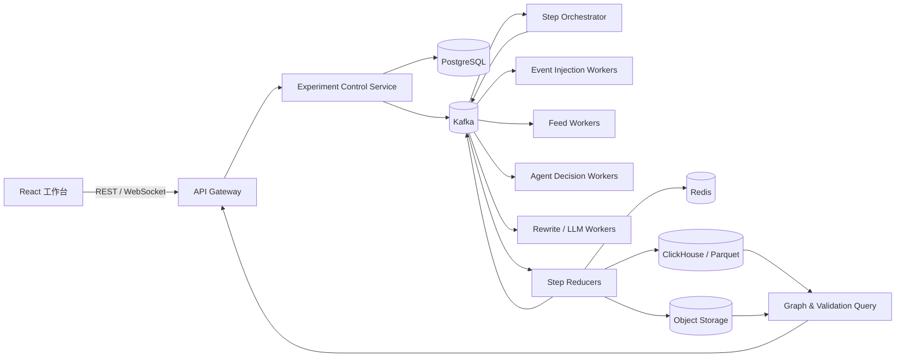
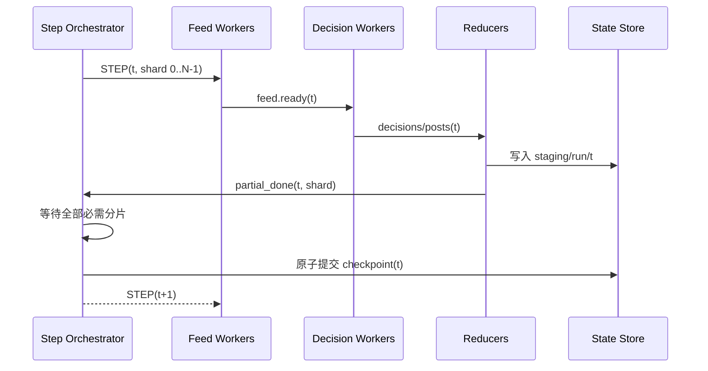

# 多事件社交传播仿真：Kafka 与实验执行架构 v1

## 1. 设计结论

本系统应拆成两个平面：

- **控制平面**负责实验定义、排队、状态机、配额、暂停/恢复、检查点和失败恢复。
- **仿真数据平面**负责每个时间步内的事件注入、候选召回、推荐排序、Agent 决策、文本改写、状态归并、指标和图谱增量。

Kafka 用于传递有序、可回放的任务与事实事件，不保存完整世界状态；PostgreSQL 保存控制状态，Redis 保存运行期热点状态，对象存储/Parquet 保存大体量日志与快照。MVP 不建议引入 Neo4j：传播图天然是追加式边流，用 ClickHouse 或 Parquet 存边、前端按事件和时间窗查询即可。

一个 Agent 不对应一个操作系统进程。Agent 是状态记录；Worker 以批次处理数百至数千个 Agent。一个实验也不应固定占用一个常驻子进程，而应由调度器分配一组短生命周期、可替换的 Worker。

## 2. 规模估算与关键约束

以 10,000 个账号、每步浏览 8 条、30 分钟一步为例：

- 每步最多 80,000 次已浏览内容决策；
- 14 天共 672 步，即最多约 5,376 万次决策；
- 若候选池为 50，则每步有约 50 万条候选排序记录；
- 2,000 个装载事件不代表 2,000 个事件同时活跃，应另外设置 `max_active_events`；
- 若所有决策都调用 LLM，成本与吞吐不可控，因此概率模型应是默认决策器，LLM 只服务于抽样账号、关键节点或文本改写。

系统必须保证：

1. 一个账号在一步内只被一个分区处理；
2. 第 `t+1` 步不能读取第 `t` 步尚未归并完成的世界状态；
3. 消息可重复投递，但业务结果不能重复写入；
4. 相同配置、数据版本、模型版本和随机种子可复现；
5. 暂停发生在时间步边界，避免留下“半步完成”的世界。

## 3. 总体架构



### 服务职责

| 服务 | 核心职责 | 是否持有权威状态 |
|---|---|---|
| API Gateway | 参数校验、查询、控制命令、WebSocket 推送 | 否 |
| Experiment Control | 实验状态机、版本快照、排队、公平调度、配额 | 是，PostgreSQL |
| Step Orchestrator | 时间步屏障、分片派发、完成计数、检查点触发 | 是，PostgreSQL |
| Injection Worker | 按计划注入事件种子帖 | 否 |
| Feed Worker | 候选召回、推荐打分、Top-N 截断 | 否 |
| Decision Worker | 在线判定、浏览与行为抽样、状态转移 | 否 |
| Rewrite Worker | 模板或 LLM 改写，失败降级 | 否 |
| Step Reducer | 汇总动作、热度、疲劳、指标、图增量 | 否；提交后写权威存储 |
| Graph/Validation Query | 事件子图、时间切片、真实/模拟曲线查询 | 否 |

## 4. Kafka 主题设计

所有消息使用 Avro 或 Protobuf，并通过 Schema Registry 做兼容性检查。公共信封：

```json
{
  "message_id": "uuid",
  "run_id": "run_...",
  "step": 86,
  "shard_id": 12,
  "attempt": 1,
  "config_version": "sha256:...",
  "seed_version": "rng-v1",
  "created_at": "...",
  "payload": {}
}
```

建议的主题如下。主题名带环境前缀，如 `sim.dev.step.command.v1`。

| Topic | 分区键 | 生产者 → 消费者 | 内容 |
|---|---|---|---|
| `experiment.command.v1` | `run_id` | Control → Orchestrator | START/PAUSE/RESUME/CANCEL |
| `step.command.v1` | `run_id:shard_id` | Orchestrator → Workers | 某步某分片执行命令 |
| `event.injection.v1` | `run_id:event_id` | Injection → Feed | 到时注入的种子帖 |
| `feed.task.v1` | `run_id:agent_shard` | Orchestrator → Feed | 账号分片的候选召回任务 |
| `feed.ready.v1` | `run_id:agent_id` | Feed → Decision | 排序后的 Top-N 信息流 |
| `decision.result.v1` | `run_id:agent_id` | Decision → Reducer/Rewrite | 行为结果与可解释因子 |
| `rewrite.task.v1` | `run_id:event_id` | Decision → Rewrite | 需要文本生成的动作 |
| `post.created.v1` | `run_id:event_id` | Rewrite/Decision → Reducer | 新帖子及父子链 |
| `step.partial.v1` | `run_id:shard_id` | Reducer → Orchestrator | 分片完成与局部聚合 |
| `step.committed.v1` | `run_id` | Orchestrator → Query/UI | 时间步已原子提交 |
| `run.telemetry.v1` | `run_id` | 全服务 → Observability | 进度、耗时、吞吐、告警 |
| `*.dlq.v1` | 原分区键 | 重试耗尽 → 运维 | 不可处理消息及错误上下文 |

不要为每个实验或事件动态创建 Topic。Topic 数量固定，通过 `run_id`、`event_id` 和分区键隔离。否则 2,000 个事件 × 多个实验会造成元数据和运维灾难。

### 分区原则

- Agent 串行性：涉及账号状态的消息以 `run_id + agent_id` 或稳定的 `agent_shard` 分区，保证同一账号同一步内有序。
- 事件聚合：帖子与传播边以 `run_id + event_id` 分区，方便构造单事件时间序列。
- 分片数写入不可变实验配置；运行中不能改变，否则会破坏确定性。
- Worker 数量可小于分区数并弹性扩缩；不要把 Kafka partition 与操作系统进程一一绑定。

## 5. 时间步屏障与执行协议

事件驱动不等于各 Worker 可以任意推进虚拟时间。本仿真应采用 **Bulk Synchronous Parallel（BSP）**：步内并行，步间设屏障。



每一步建议细分为确定的 stage：

1. `INJECT`：把本步到期事件和外部刺激写入只读输入集；
2. `FEED`：基于步开始快照召回、排序并截取 N 条；
3. `DECIDE`：Agent 对 N 条内容产生动作；
4. `REWRITE`：只处理需要改写的动作；
5. `REDUCE`：归并新帖、传播边、热度、记忆、疲劳和指标；
6. `COMMIT`：发布该步检查点与 UI 增量。

默认采用“本步产生的帖子在下一步可见”，可以消除步内执行顺序对结果的影响。若研究需要步内级联，必须增加 `micro_step`，而不能让消息到达先后决定传播结果。

### 屏障实现

PostgreSQL 维护 `(run_id, step, stage, shard_id, status, checksum, attempt)`。Orchestrator 仅在所有必需分片为 `SUCCEEDED` 且校验数量一致时提交。Kafka consumer offset 不是仿真完成状态，不能仅凭 lag=0 推进下一步。

## 6. 实验与子进程管理

### 6.1 状态机

```text
DRAFT → QUEUED → PREPARING → RUNNING ⇄ PAUSING → PAUSED
                               │  │                    │
                               │  └→ CANCELLING → CANCELLED
                               ├────→ FAILED
                               └────→ COMPLETED
PAUSED → QUEUED（重新获取运行配额后恢复）
FAILED → QUEUED（从最近已提交检查点重试）
```

- `PAUSE` 是协作式暂停：停止派发下一步，等待当前步提交后进入 `PAUSED`。
- `CANCEL` 先停止新任务，再终止未开始的任务；已提交检查点和产物保留。
- 强制终止只用于超时或失联 Worker；恢复时丢弃当前未提交的 staging 数据。
- 状态转换用数据库行版本或 compare-and-swap，避免按钮重复点击产生双重启动。

### 6.2 运行单元

生产环境推荐 Kubernetes：

- Control、Orchestrator、Query 是 Deployment；
- CPU 型 Feed/Decision/Reducer 是可自动扩缩的 Deployment；
- LLM Worker 独立队列和 GPU 节点池；
- 大型一次性初始化（人群/网络生成）可用 Job；
- KEDA 根据 Kafka lag 扩缩，但 Orchestrator 仍掌握实验级并发配额。

本地 MVP 推荐 Docker Compose，包含 Kafka（KRaft）、PostgreSQL、Redis、MinIO 和各 Worker。用一个 Python `multiprocessing` Supervisor 启动固定 Worker 池即可，不要从 Node/React 直接 fork 仿真进程。

Supervisor 对子进程保存：

```yaml
worker_id: decision-03
pid: 18420
worker_type: decision
assigned_partitions: [6, 7]
started_at: ...
last_heartbeat_at: ...
current_run_id: run_021
current_step: 86
status: healthy | draining | lost
restart_count: 1
```

失联判定建议为连续 3 个心跳周期；采用指数退避重启，并设置每 10 分钟最大重启次数。进程退出不直接判实验失败：未提交消息由 Kafka 重投，只有超过任务最大尝试次数才进入 DLQ，并将实验转为 `FAILED` 或 `NEEDS_ATTENTION`。

### 6.3 公平调度和资源配额

现有前端“并行槽位”应升级为带权配额，而不是一个简单数字：

```yaml
run_resources:
  cpu_slots: 8
  llm_slots: 2
  max_inflight_agent_shards: 32
  max_active_events: 200
  priority: normal
```

调度采用加权公平队列；同一用户设置最大并发运行数。LLM 队列与普通决策队列隔离，避免文本生成阻塞整个时间步。每步可为 LLM 设置预算和超时，超限自动降级到模板改写。

## 7. 幂等、重试与可复现性

Kafka 在此采用 **at-least-once + 业务幂等**，不把“exactly once”当作跨数据库、对象存储和模型调用的万能保证。

- 幂等键：`run_id / step / stage / shard_id / entity_id / action_index`；
- PostgreSQL/ClickHouse 写入使用唯一键或版本化去重；
- staging 路径包含 step 与 attempt，只有 COMMIT 指针可见；
- LLM 请求以内容哈希做缓存，重试复用结果；
- Outbox 表保证数据库状态转换与 Kafka 控制消息最终一致；
- Worker 先写结果，再确认 Kafka offset；重复消费只命中相同幂等键。

随机数不能使用“消费顺序相关”的全局 RNG。建议：

```text
rng_seed = hash(run_seed, step, agent_id, post_id, decision_type)
```

同时冻结：实验配置哈希、输入数据快照 ID、网络快照 ID、代码镜像 digest、推荐/行为模型版本、提示词版本和 LLM 参数。若调用非确定性外部模型，应把原始请求和返回缓存为实验资产，并将运行标为“可回放但非重新生成可复现”。

## 8. 数据与存储分层

| 数据 | 推荐存储 | 保留策略 |
|---|---|---|
| 实验定义、状态、检查点、版本 | PostgreSQL | 长期 |
| Agent 当前状态、热榜、步内缓存 | Redis | 运行期，可由检查点恢复 |
| 决策事实、曝光、帖子、传播边、指标 | ClickHouse | 按实验 TTL/归档 |
| 人群/网络/事件输入快照 | Parquet + 对象存储 | 长期、内容寻址 |
| 步检查点、导出、动画帧、验证报告 | 对象存储 | 按项目策略 |
| Kafka 消息 | Kafka | 7–30 天回放窗口，不作永久档案 |

最小事实表建议：

- `exposure_fact(run_id, step, agent_id, post_id, event_id, rank, score, source)`；
- `decision_fact(..., action, probability, sampled_value, factors)`；
- `post_fact(post_id, event_id, author_id, parent_post_id, text_ref, mode)`；
- `diffusion_edge(run_id, step, event_id, source_agent_id, target_agent_id, post_id)`；
- `event_step_metric(run_id, step, event_id, exposures, propagators, posts, cross_community)`；
- `agent_event_state_delta(run_id, step, agent_id, event_id, from_state, to_state)`。

只存状态变化 delta，按固定间隔（如每 12 步）生成全量检查点。恢复时加载最近全量检查点，再重放后续已提交 delta。

## 9. 图谱染色与实时展示

前端不应直接消费 Kafka。`Graph Query Service` 读取已提交的事实数据，WebSocket 只发送降采样后的增量：

```json
{
  "run_id": "run_021",
  "step": 86,
  "event_id": "evt_x",
  "node_deltas": [{"agent_id":"a1","state":"propagated","intensity":0.8}],
  "edge_deltas": [{"source":"a0","target":"a1","post_id":"p9"}],
  "metrics": {"exposed":4820,"propagated":1204}
}
```

展示层分三级：

1. **全局概览**：社区聚合后的超节点，显示 Top-N 事件份额；
2. **锁定事件**：灰色未触达、浅色已曝光、深色已传播，边仅显示该事件；
3. **局部追踪**：选择关键账号后，按时间窗加载传播子图和文本变体链。

10,000 节点可用 WebGL 渲染；更大规模默认展示社区聚合。2,000 个事件不使用 2,000 种颜色，只给关注事件和 Top-N 分配颜色，其余归入“其他”。UI 只能展示 `step.committed` 后的数据，避免出现随后回滚的半步结果。

## 10. Agent 画像构建管线

画像必须标注来源等级：`observed`（观测）、`estimated`（估计）、`assumed`（实验假设）。建议离线构建：

1. 对真实账号做匿名化和最小化处理；
2. 计算发帖频率、活跃时段、事件进入时机、互动分布、主题向量；
3. 聚类成媒体、机构、创作者、普通用户、桥接节点等原型；
4. 以分布采样生成合成账号；
5. 用目标度分布、社区结构和同配性生成网络；
6. 输出不可变 `population_snapshot_id` 与 `network_snapshot_id`。

行为模型分两层：概率模型决定 `ignore/like/repost/comment/rewrite`，文本模型只处理需要语义生成的动作。这样能对“传播动力学误差”和“文本生成误差”分别做消融实验。

## 11. 真实趋势校验

同一事件的真实与模拟数据先统一到相同的：时间原点、30 分钟桶、观察窗口和统计口径。主指标建议为累计独立参与账号数，辅以帖子数、峰值、到峰时间、T10/T50/T90、DTW、RMSE、跨社区次数和集中度。

每组参数至少运行多个随机种子，展示中位数及 10%–90% 区间。训练/验证/测试事件严格隔离；校准流程本身也是一种实验，应保存参数搜索空间、目标函数和最佳参数来源。

建议先做四类消融：

- 无注意力限制 vs 每步浏览 8 条；
- 仅兴趣排序 vs 兴趣 + 热度；
- 单事件运行 vs 200/2,000 事件竞争；
- 纯概率 Agent vs 关键节点启用 LLM。

## 12. API 草案

```text
POST   /api/experiments                 创建不可变实验版本
POST   /api/runs                        提交运行
POST   /api/runs/{id}:pause             步边界暂停
POST   /api/runs/{id}:resume            从检查点恢复并重新排队
POST   /api/runs/{id}:cancel            取消并保留已提交资产
GET    /api/runs/{id}                   状态、当前步、各 stage 进度
GET    /api/runs/{id}/events            事件竞争榜
GET    /api/runs/{id}/events/{eid}/graph?step=86
GET    /api/runs/{id}/events/{eid}/curve
GET    /api/runs/{id}/agents/{aid}/feed?step=86
GET    /api/runs/{id}/validation
GET    /api/runs/{id}/stream            WebSocket/SSE 进度与图增量
```

所有控制接口接受 `Idempotency-Key`。运行配置创建后不可原地修改；更改参数通过复制实验版本完成。

## 13. 可观测性与验收

至少监控：Kafka consumer lag、每 stage p50/p95 时延、每秒 Agent 数、每步决策量、LLM 降级率、重复消息去重数、DLQ 数、检查点大小与恢复时间。

端到端验收：

1. 重复投递同一消息不会产生重复帖子或传播边；
2. 任意杀死一个 Worker，实验能从 Kafka 重试并完成当前步；
3. 当前步执行中点击暂停，系统在该步提交后稳定暂停；
4. 从检查点恢复后，确定性模式的指标与未中断运行一致；
5. 每个账号每步 `selected_for_feed <= browse_capacity`；
6. 2,000 个已装载事件、200 个同时活跃事件下，不动态创建 Topic；
7. 单事件图可按任意已提交时间步回放；
8. 任意传播动作可追溯到曝光、排名、概率、随机抽样值和父帖子；
9. 模拟与真实曲线使用同一分桶函数；
10. UI 不展示未提交步的数据。

## 14. 分阶段落地

### Phase 0：确定性单进程内核

先实现不依赖 Kafka 的纯函数仿真内核与固定随机数协议。用小规模数据验证一步输入/输出、幂等键和真实曲线口径。

### Phase 1：Kafka MVP

接入 PostgreSQL、Kafka、Redis/MinIO；实现 Control、Orchestrator、Feed、Decision、Reducer；支持 10–200 事件、概率决策、模板改写、暂停/恢复和图增量。

### Phase 2：规模化与校验

接入 ClickHouse/Parquet、Kubernetes/KEDA、多随机种子批次、验证中心和故障注入测试；逐步提升到 2,000 个装载事件。

### Phase 3：生成式 Agent

增加独立 LLM 队列、预算、缓存、结构化输出与模板降级；只在消融实验表明其对真实趋势拟合或文本演化研究有增益后扩大覆盖率。

## 15. 与当前仓库的衔接点

- `src/AppShell.jsx` 中 localStorage 的实验状态迁移到 Control API；
- 现有 `slots` 替换为实验资源配额与服务端队列位置；
- `NetworkMap` 改为订阅已提交 `node_deltas/edge_deltas`；
- `database/background-events.sqlite` 继续作为本地事件目录，运行创建时导出内容寻址的事件快照；
- 当前“固定样例验证曲线”替换为 `/validation` 聚合结果；
- 前端状态只作缓存，服务器端 PostgreSQL 才是运行状态真源。

首个可执行里程碑应是：**1,000 个 Agent、20 个事件、48 个时间步；支持杀死 Worker 后恢复；同一种子结果哈希一致；能回放一个事件的染色图并与真实曲线对齐。** 达成后再扩到 10,000 Agent 和 2,000 个装载事件。
